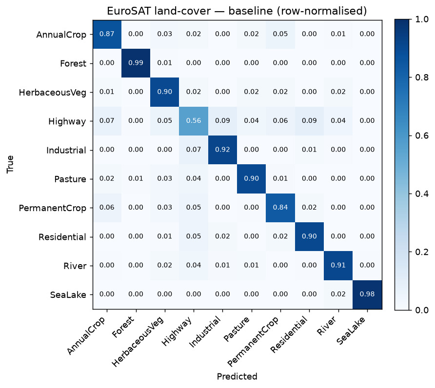

# eo-landcover

**Land-cover classification and change detection from Sentinel-2 satellite imagery.**

A hands-on project for learning the Earth-observation / remote-sensing stack, built
around **EuroSAT** (Sentinel-2 patches, 10 land-cover classes). It mirrors the shape
of real operational work — extract validated markers from satellite imagery, then
move from simple features to learned embeddings and change detection.

> This is partly a **learning scaffold**: the reusable domain logic is implemented
> and tested, while the satellite-imagery modelling is left as guided `TODO`s so the
> remote-sensing part is something I build and understand, not a black box.

## What's implemented (tested, no heavy deps)

- **`indices`** — spectral indices (NDVI and normalised differences) from bands.
- **`metrics`** — accuracy, per-class accuracy, confusion matrix (per-class matters:
  land-cover classes are imbalanced).
- **`change`** — change detection from image embeddings (cosine distance + thresholding).
- **`split`** — stratified train/val/test splits that preserve class proportions.
- Tests + GitHub Actions CI (lint + test on Python 3.10 / 3.12).

## What's a guided scaffold (the learning)

- **`data`** — load EuroSAT via TorchGeo; turn patches into simple features.
- **`model`** — a pretrained CNN classifier, and the same model as an embedding extractor.
- **`examples/02_train_baseline.py`** — the end-to-end baseline, wired up and waiting
  for the `data` TODOs.

## Quickstart

Core + the runnable change-detection demo (no satellite download needed):

```bash
pip install -e '.[dev,plots]'
pytest -q                               # the implemented core is tested
python examples/03_change_detection.py  # change detection on simulated embeddings
```

For the imagery work (downloads EuroSAT the first time):

```bash
pip install -e '.[torch]'
python examples/01_explore_eurosat.py   # look at a few patches + their NDVI
python examples/02_train_baseline.py    # train + evaluate the baseline
```

## Results — baseline

Each 64×64 patch is reduced to simple, interpretable features — per-band mean and
standard deviation plus mean NDVI — and classified with a RandomForest on a
stratified 70/15/15 split. No deep learning.

**Test accuracy: 88%** across the 10 classes (chance is 10%); validation 88.5% and
test 88.0% track closely, so the model isn't overfitting.



The confusion matrix (row-normalised, so the diagonal is per-class recall) tells a
clear story. Spectrally uniform classes are easy — **Forest 0.99, SeaLake 0.98**.
The one weak class is **Highway (0.56)**, which scatters into AnnualCrop,
Residential, Industrial and others.

That failure is informative rather than disappointing: a highway is a **thin, linear**
feature, and collapsing a patch to per-band *statistics* discards *where* things
are — so a mostly-crop patch with a road through it looks spectrally like crops.
The baseline's main weakness is precisely the class defined by spatial structure,
which is the motivation for the next step: a representation that **keeps** spatial
layout (a CNN, or embeddings from one).

## Learning roadmap

1. **Explore** — load EuroSAT, look at a few patches and their bands, compute NDVI.
   Learn how Sentinel-2 imagery is shaped (13 bands, patch size, class labels).
2. **Baseline** — per-band summary features + NDVI → RandomForest; report accuracy,
   per-class accuracy, confusion matrix. A no-deep-learning number to beat.
3. **Embeddings** — use a pretrained (satellite) CNN as a feature extractor; classify
   from embeddings; compare to the baseline.
4. **Change detection** — embed two acquisitions of the same area and flag change by
   embedding distance (`change.py`) — the direction operational teams are moving.
5. **Write it up** — a short README results section + a blog-style note, the same
   "document and communicate" habit the work itself needs.

## Why this project

Earth observation turns satellite data into decisions about agriculture, land, and
climate. The hard part is rarely a single model — it's validated, reproducible markers
and honest evaluation on messy real-world imagery. This repo is scaffolded around that:
metrics and splits that don't fool you, simple interpretable features before fancy ones,
and change detection framed as a distance in a learned space.

## License

MIT.
